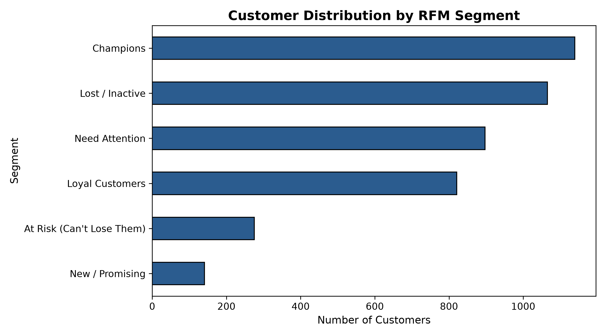

# E-Commerce Customer Segmentation & RFM Churn Analysis

An end-to-end data analytics and customer segmentation engine designed to analyze transaction records, identify revenue concentration, and categorize customer bases using Recency, Frequency, and Monetary (RFM) modeling.



---

## Executive Summary

Marketing departments often dilute ROI by distributing broad campaigns to undifferentiated audiences. This project builds a systematic customer segmentation pipeline that:
1. Cleans and processes over 500,000 raw transactional e-commerce records.
2. Applies mathematical quintile ranking across Recency, Frequency, and Monetary dimensions.
3. Groups customers into actionable behavioral cohorts (*Champions, Loyal, At Risk, Lost*), identifying where churn interventions protect top-line revenue.

---

## Tech Stack

- **Data Processing:** Python (Pandas, NumPy)
- **Database / Query Engine:** PostgreSQL / SQLite (Window Functions, CTEs)
- **Visualization:** Matplotlib / Seaborn / Power BI
- **Dataset:** Online Retail Dataset (UCI Machine Learning Repository / Kaggle)

---

## Pipeline Architecture

## Key SQL Implementation

The core feature engineering leverages Common Table Expressions (CTEs) and `NTILE` window functions to rank customers dynamically relative to a snapshot anchor date:

```sql
WITH CustomerMetrics AS (
    SELECT 
        CustomerID,
        MAX(InvoiceDate) AS LastPurchaseDate,
        COUNT(DISTINCT InvoiceNo) AS Frequency,
        SUM(Quantity * UnitPrice) AS MonetaryValue
    FROM online_retail
    WHERE CustomerID IS NOT NULL AND Quantity > 0 AND UnitPrice > 0
    GROUP BY CustomerID
),
SnapshotAnchor AS (
    SELECT MAX(LastPurchaseDate) + INTERVAL '1 day' AS RefDate FROM CustomerMetrics
)
SELECT 
    c.CustomerID,
    DATE_PART('day', s.RefDate - c.LastPurchaseDate) AS RecencyDays,
    c.Frequency,
    ROUND(CAST(c.MonetaryValue AS NUMERIC), 2) AS Monetary,
    NTILE(5) OVER (ORDER BY DATE_PART('day', s.RefDate - c.LastPurchaseDate) DESC) AS R_Score,
    NTILE(5) OVER (ORDER BY c.Frequency ASC) AS F_Score,
    NTILE(5) OVER (ORDER BY c.MonetaryValue ASC) AS M_Score
FROM CustomerMetrics c
CROSS JOIN SnapshotAnchor s;